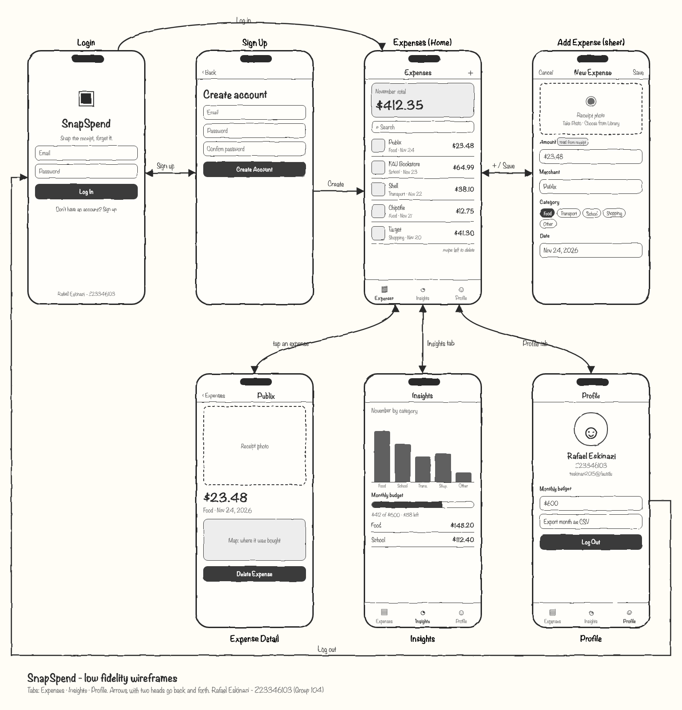
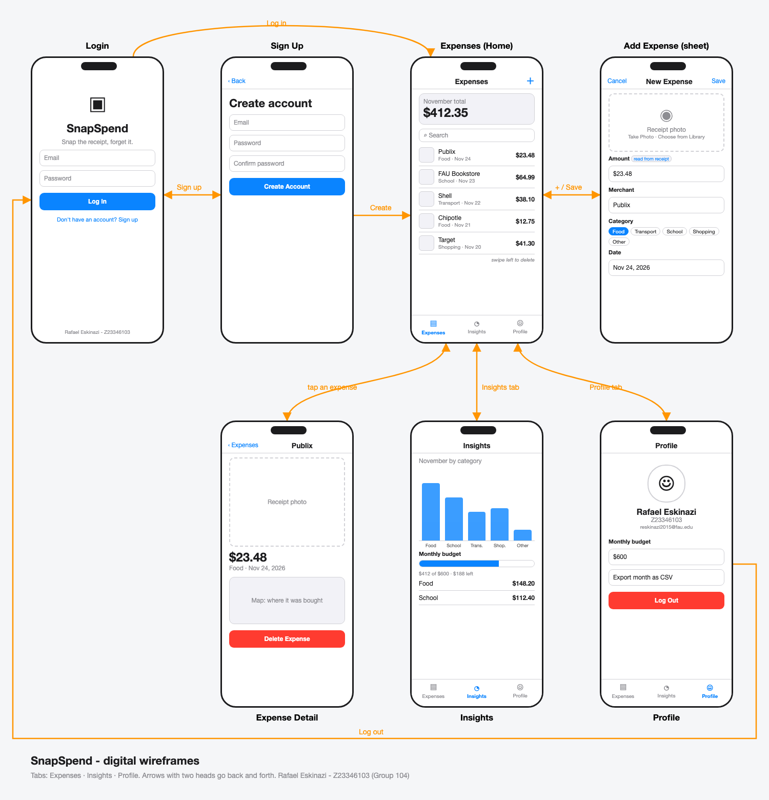
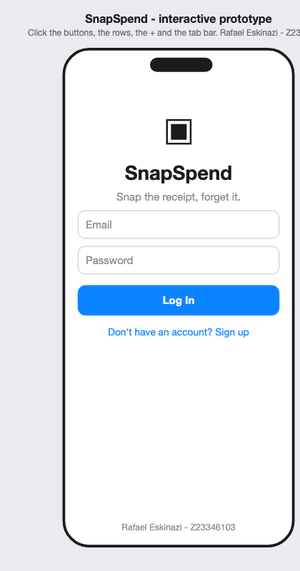

Original App Design Project - README
===

# SnapSpend

Group 104 - Rafael Eskinazi (Z23346103)

COP 4655 - iOS Mobile App Development, Florida Atlantic University, Fall 2026

## Table of Contents

1. [Overview](#Overview)
2. [Product Spec](#Product-Spec)
3. [Wireframes](#Wireframes)
4. [Schema](#Schema)

## Overview

### Description

SnapSpend is a personal expense tracker. Instead of typing every expense, the user takes a picture of the receipt and the app reads the total with on-device text recognition. The user picks a category (food, transport, school, etc.) and the expense is saved in Firebase with the photo, the date and where it was bought. The home screen shows this month's total and the list of expenses, and the Insights tab shows a chart of spending by category and a monthly budget.

### App Evaluation

- **Category:** Finance / Productivity
- **Mobile:** Yes, it is built around the phone: the camera to take the receipt photo, Apple's Vision framework to read the total from the photo, and location to save where the purchase was made. Taking the photo at the store is the main flow and only makes sense on a phone.
- **Story:** "Snap the receipt and forget it." At the end of the month you know where your money went without saving paper receipts or typing everything in a spreadsheet.
- **Market:** Students and young people on a budget, freelancers, and employees who need to keep receipts to get reimbursed by their company.
- **Habit:** Daily/weekly use. The user opens it every time they buy something and checks the monthly total and the chart a few times a week. The user creates content (expenses) and also consumes it (totals and charts).
- **Scope:** Narrow and well defined. The MVP is login, add an expense with a photo, the list, the detail and delete. Text recognition is the hardest part, but the amount can always be typed by hand, so the app still works if it fails. Charts, budget and the map are optional and can be added in the second sprint.

## Product Spec

### 1. User Stories (Required and Optional)

**Required Must-have Stories**

* User can create a new account with email and password
* User can log in and stays logged in after closing the app
* User can log out
* User can add an expense by taking a photo of a receipt (or choosing one from the photo library)
* App reads the total from the receipt photo and fills in the amount, and the user can edit it
* User can enter the merchant, pick a category and change the date of an expense
* User can see a list of their expenses, newest first, with this month's total at the top
* User can tap an expense to see its details and the receipt photo
* User can delete an expense
* User's name and Z number are shown in the app (Profile screen)

**Optional Nice-to-have Stories**

* User can see a chart of this month's spending by category (Swift Charts)
* User can set a monthly budget and see a progress bar of how much is left
* App saves the location of the purchase and the detail screen shows it on a map
* User can search expenses by merchant and filter by category
* User can edit an expense after saving it
* User can add an expense in another currency and it is converted to USD with a currency API
* User can export the month's expenses as a CSV file with the share sheet
* App sends a notification when the user goes over 80% of the budget

### 2. Screen Archetypes

- [ ] **Login Screen**
  * User can log in
- [ ] **Sign Up Screen**
  * User can create a new account with email and password
- [ ] **Expenses Screen (Home)**
  * User can see a list of their expenses, newest first, with this month's total at the top
  * User can delete an expense (swipe to delete)
  * (Optional) User can search expenses and filter by category
- [ ] **Add Expense Screen**
  * User can add an expense by taking a photo of a receipt or choosing one from the library
  * App reads the total from the receipt photo, the user can edit it
  * User can enter the merchant, pick a category and change the date
- [ ] **Expense Detail Screen**
  * User can see the details and the receipt photo of an expense
  * User can delete an expense
  * (Optional) Map with the location of the purchase, edit the expense
- [ ] **Insights Screen**
  * (Optional) Chart of spending by category
  * (Optional) Monthly budget with a progress bar
- [ ] **Profile Screen**
  * User's name and Z number
  * User can log out
  * (Optional) User can set the monthly budget, export CSV

### 3. Navigation

**Tab Navigation** (Tab to Screen)

- [ ] Expenses
- [ ] Insights
- [ ] Profile

**Flow Navigation** (Screen to Screen)

- [ ] **Login Screen**
  * Leads to **Expenses Screen** (after logging in)
  * Leads to **Sign Up Screen**
- [ ] **Sign Up Screen**
  * Leads to **Expenses Screen** (after creating the account)
  * Leads back to **Login Screen**
- [ ] **Expenses Screen**
  * Leads to **Add Expense Screen** (+ button, opens as a sheet)
  * Leads to **Expense Detail Screen** (tap an expense)
- [ ] **Add Expense Screen**
  * Leads back to **Expenses Screen** (Save or Cancel)
- [ ] **Expense Detail Screen**
  * Leads back to **Expenses Screen** (back button, or after deleting)
- [ ] **Insights Screen**
  * None (tab)
- [ ] **Profile Screen**
  * Leads to **Login Screen** (after logging out)

## Wireframes

Low fidelity wireframes with the screens and the navigation between them:

### [BONUS] Digital Wireframes & Mockups

### [BONUS] Interactive Prototype

Clickable prototype made with HTML (open `prototype/index.html` in a browser):

## Schema

[This section will be completed in Unit 9]

### Models

**User** (Firebase Authentication + `users` collection)

| Property      | Type   | Description                               |
|---------------|--------|-------------------------------------------|
| uid           | String | unique id of the user (from Firebase Auth) |
| email         | String | user's email, used to log in              |
| monthlyBudget | Double | (optional) budget for the month in USD    |

**Expense** (`expenses` collection)

| Property     | Type    | Description                                        |
|--------------|---------|----------------------------------------------------|
| id           | String  | unique id of the expense                           |
| userId       | String  | uid of the user that owns the expense              |
| merchant     | String  | name of the store                                  |
| amount       | Double  | total of the receipt                               |
| category     | String  | food, transport, school, shopping, bills or other  |
| date         | Date    | date of the purchase                               |
| receiptImage | Data    | compressed JPEG of the receipt photo               |
| latitude     | Double? | (optional) where the expense was added             |
| longitude    | Double? | (optional) where the expense was added             |
| createdAt    | Date    | when the expense was saved                         |

### Networking

- Login / Sign Up Screens
  - `Auth.auth().signIn(withEmail:password:)` and `createUser(withEmail:password:)`
- Expenses Screen
  - `[GET]` listen to `expenses` where `userId == currentUser.uid`, ordered by `date` (snapshot listener)
  - `[DELETE]` delete an expense document
- Add Expense Screen
  - `[POST]` save a new document in `expenses`
  - Text recognition runs on the phone with `VNRecognizeTextRequest` (no network)
- Expense Detail Screen
  - `[DELETE]` delete the expense document
- Insights / Profile Screens
  - `[GET]` / `[PUT]` `users/{uid}` to read and update the monthly budget
- (Optional) Currency conversion: `[GET] https://api.frankfurter.dev/v1/latest?base=EUR&symbols=USD` (free, no API key)
